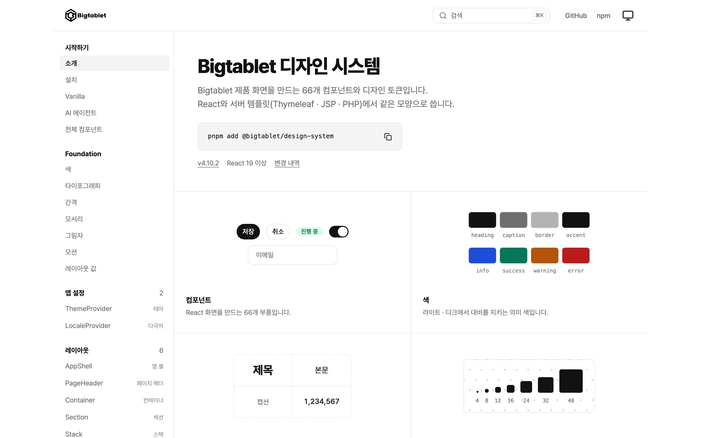
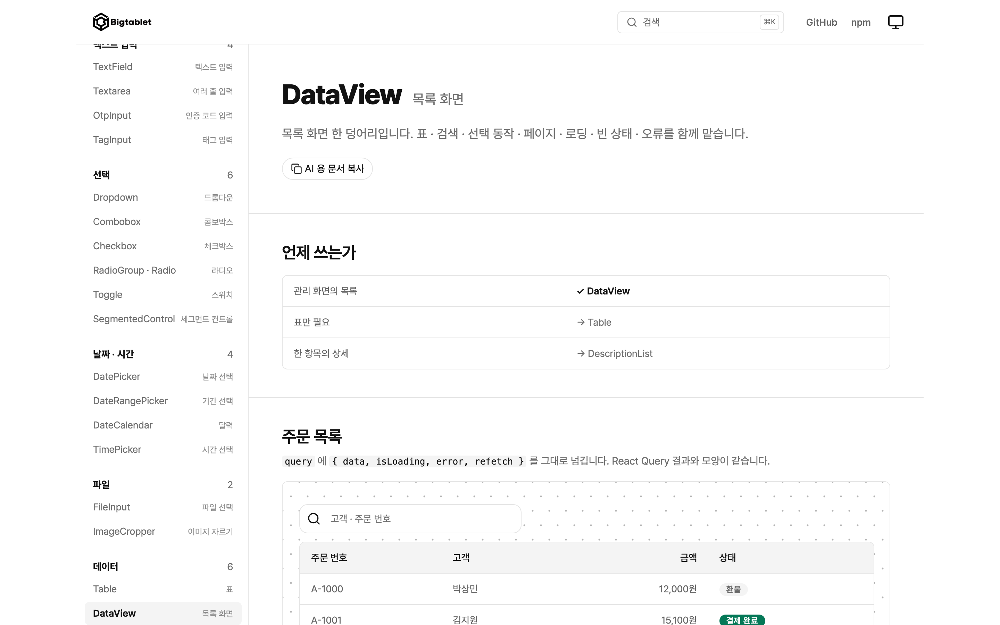

<div align="center">


<br />
<br />

### Bigtablet Design System

The unified UI library powering Bigtablet products.<br />
Crafted for clarity. Built on tokens. Ships with dark mode.

<br />

<p>
  <a href="https://www.npmjs.com/package/@bigtablet/design-system"></a>
  <a href="https://github.com/Bigtablet/.github/blob/main/BIGTABLET_LICENSE.md"></a>
  <a href="https://github.com/Bigtablet/bigtablet-design-system/actions/workflows/ci.yml"></a>
</p>

[**Docs site**](https://bigtablet.github.io/bigtablet-design-system/)&nbsp;&nbsp;·&nbsp;&nbsp;[NPM](https://www.npmjs.com/package/@bigtablet/design-system)&nbsp;&nbsp;·&nbsp;&nbsp;[Changelog](./CHANGELOG.md)&nbsp;&nbsp;·&nbsp;&nbsp;[🇰🇷 한국어](./README_KR.md)

<br />

<a href="https://bigtablet.github.io/bigtablet-design-system/">
  <picture>
    <source media="(prefers-color-scheme: dark)" srcset="https://raw.githubusercontent.com/Bigtablet/bigtablet-design-system/main/.github/assets/home-dark.png" />
    
  </picture>
</a>

</div>

<br />

## Install

```bash
pnpm add @bigtablet/design-system react@^19 react-dom@^19 lucide-react
```

```tsx
import { ThemeProvider, ToastProvider, Button, useToast } from "@bigtablet/design-system";
// No CSS import needed - each component brings its own CSS.

export default function App() {
  return (
    <ThemeProvider>
      <ToastProvider>
        <SaveButton />
      </ToastProvider>
    </ThemeProvider>
  );
}

function SaveButton() {
  const toast = useToast();
  return <Button onClick={() => toast.success("Saved")}>Save</Button>;
}
```

Next.js App Router works as is. Setup details, Tailwind v4 and SCSS tokens are on the [install page](https://bigtablet.github.io/bigtablet-design-system/#/install).

<br />

## What's inside

<a href="https://bigtablet.github.io/bigtablet-design-system/#/data-view">
  <picture>
    <source media="(prefers-color-scheme: dark)" srcset="https://raw.githubusercontent.com/Bigtablet/bigtablet-design-system/main/.github/assets/data-view-dark.png" />
    
  </picture>
</a>

- **60+ components** - forms, display, feedback, navigation, overlay, layout, plus screen-level pieces like `DataView`
- **Design tokens** - colors, typography, spacing, motion and more as SCSS variables and CSS custom properties
- **Light + dark mode** - `[data-theme="dark"]` or `prefers-color-scheme`, runtime toggling via `ThemeProvider`
- **Vanilla JS bundle** - the same look in Thymeleaf, JSP, PHP, Django ([guide](https://bigtablet.github.io/bigtablet-design-system/#/vanilla))
- **Korean line breaking** - `BalancedText` at `@bigtablet/design-system/text`
- **Docs for AI agents** - [`llms.txt`](https://bigtablet.github.io/bigtablet-design-system/llms.txt) and `dist/llms` in the package ([guide](https://bigtablet.github.io/bigtablet-design-system/#/ai))
- **Accessibility tested** - axe-core on every docs example in CI

Maintained for Bigtablet's own products and open for reference. Minor versions may include breaking changes - check [MIGRATION](./docs/MIGRATION.md#업그레이드-체크리스트) before upgrading.

<br />

## More docs

| | |
|---|---|
| 🔄 [Migration](./docs/MIGRATION.md) | Upgrade checklist + what to change per version |
| 🎨 [Theming](./docs/THEMING.md) | Light/dark theme system |
| 🏗️ [Architecture](./docs/ARCHITECTURE.md) | Project structure + design principles |
| 🤝 [Contributing](./docs/CONTRIBUTING.md) | Dev setup (`pnpm install` · `pnpm site` on :6007) + workflow |
| 🧪 [Testing](./docs/TESTING.md) | Test patterns + a11y testing |

<br />

## License

Licensed under the [Bigtablet License](https://github.com/Bigtablet/.github/blob/main/BIGTABLET_LICENSE.md).
