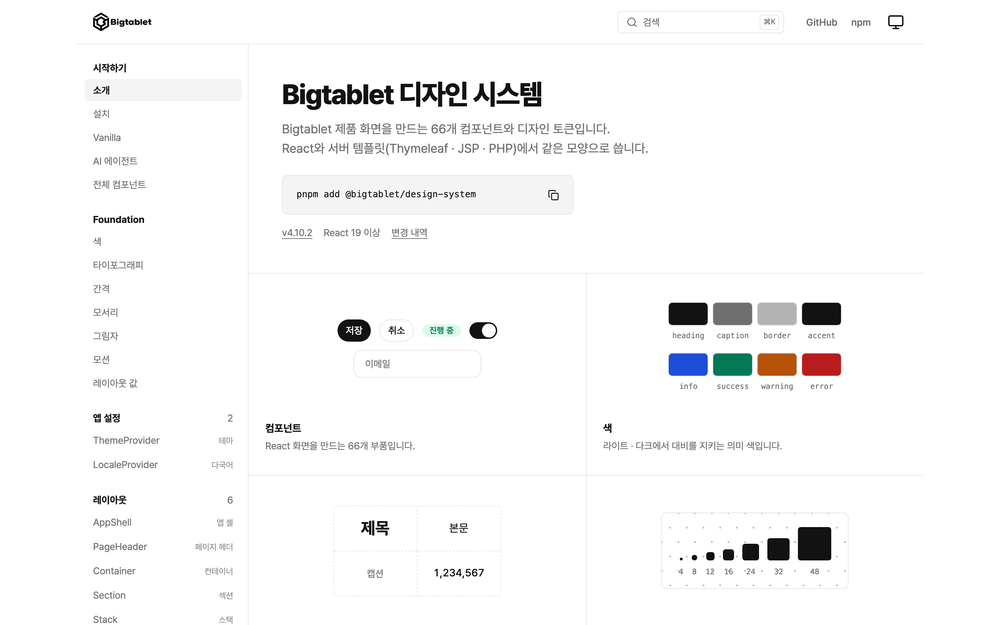
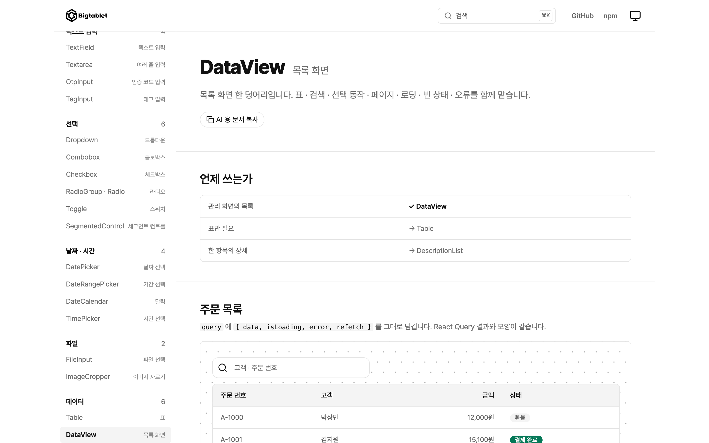

<div align="center">


<br />
<br />

### Bigtablet Design System

Bigtablet 제품을 만드는 UI 라이브러리입니다.<br />
디자인 토큰 위에 만들었고, 다크 모드가 기본으로 들어 있습니다.

<br />

<p>
  <a href="https://www.npmjs.com/package/@bigtablet/design-system"></a>
  <a href="https://github.com/Bigtablet/.github/blob/main/BIGTABLET_LICENSE.md"></a>
  <a href="https://github.com/Bigtablet/bigtablet-design-system/actions/workflows/ci.yml"></a>
</p>

[**문서 사이트**](https://bigtablet.github.io/bigtablet-design-system/)&nbsp;&nbsp;·&nbsp;&nbsp;[NPM](https://www.npmjs.com/package/@bigtablet/design-system)&nbsp;&nbsp;·&nbsp;&nbsp;[변경 내역](./CHANGELOG.md)&nbsp;&nbsp;·&nbsp;&nbsp;[🇺🇸 English](./README.md)

<br />

<a href="https://bigtablet.github.io/bigtablet-design-system/">
  <picture>
    <source media="(prefers-color-scheme: dark)" srcset="https://raw.githubusercontent.com/Bigtablet/bigtablet-design-system/main/.github/assets/home-dark.png" />
    
  </picture>
</a>

</div>

<br />

## 설치

```bash
pnpm add @bigtablet/design-system react@^19 react-dom@^19 lucide-react
```

```tsx
import { ThemeProvider, ToastProvider, Button, useToast } from "@bigtablet/design-system";
// CSS import 는 필요 없습니다 - 컴포넌트가 자기 CSS 를 불러옵니다.

export default function App() {
  return (
    <ThemeProvider>
      <ToastProvider>
        <SaveButton />
      </ToastProvider>
    </ThemeProvider>
  );
}

function SaveButton() {
  const toast = useToast();
  return <Button onClick={() => toast.success("저장했습니다")}>저장</Button>;
}
```

Next.js App Router 에서도 그대로 씁니다. 자세한 설정과 Tailwind v4 · SCSS 토큰은 [설치 페이지](https://bigtablet.github.io/bigtablet-design-system/#/install)에 있습니다.

<br />

## 구성

<a href="https://bigtablet.github.io/bigtablet-design-system/#/data-view">
  <picture>
    <source media="(prefers-color-scheme: dark)" srcset="https://raw.githubusercontent.com/Bigtablet/bigtablet-design-system/main/.github/assets/data-view-dark.png" />
    
  </picture>
</a>

- **60개 이상의 컴포넌트** - 폼 · 표시 · 피드백 · 내비게이션 · 오버레이 · 레이아웃, `DataView` 같은 화면 단위 부품까지
- **디자인 토큰** - 색 · 타이포그래피 · 간격 · 모션 등을 SCSS 변수와 CSS 변수로 제공합니다
- **라이트 + 다크 모드** - `[data-theme="dark"]` 나 `prefers-color-scheme`, 런타임 전환은 `ThemeProvider`
- **Vanilla JS 번들** - Thymeleaf · JSP · PHP · Django 에서도 같은 모양 ([가이드](https://bigtablet.github.io/bigtablet-design-system/#/vanilla))
- **한국어 줄바꿈** - `@bigtablet/design-system/text` 의 `BalancedText`
- **AI 에이전트용 문서** - [`llms.txt`](https://bigtablet.github.io/bigtablet-design-system/llms.txt) 와 패키지 안 `dist/llms` ([가이드](https://bigtablet.github.io/bigtablet-design-system/#/ai))
- **접근성 검사** - CI 에서 문서 예제마다 axe-core 를 돌립니다

Bigtablet 제품용으로 관리하고 참고용으로 공개합니다. minor 버전에도 깨지는 변경이 있을 수 있으니 올리기 전에 [MIGRATION](./docs/MIGRATION.md#업그레이드-체크리스트)을 확인해 주세요.

<br />

## 문서

| | |
|---|---|
| 🔄 [Migration](./docs/MIGRATION.md) | 업그레이드 체크리스트와 버전별 변경 사항 |
| 🎨 [Theming](./docs/THEMING.md) | 라이트/다크 테마 시스템 |
| 🏗️ [Architecture](./docs/ARCHITECTURE.md) | 프로젝트 구조와 설계 원칙 |
| 🤝 [Contributing](./docs/CONTRIBUTING.md) | 개발 환경(`pnpm install` · `pnpm site` :6007)과 작업 흐름 |
| 🧪 [Testing](./docs/TESTING.md) | 테스트 패턴과 접근성 테스트 |

<br />

## 라이센스

[Bigtablet License](https://github.com/Bigtablet/.github/blob/main/BIGTABLET_LICENSE.md) 를 따릅니다.
